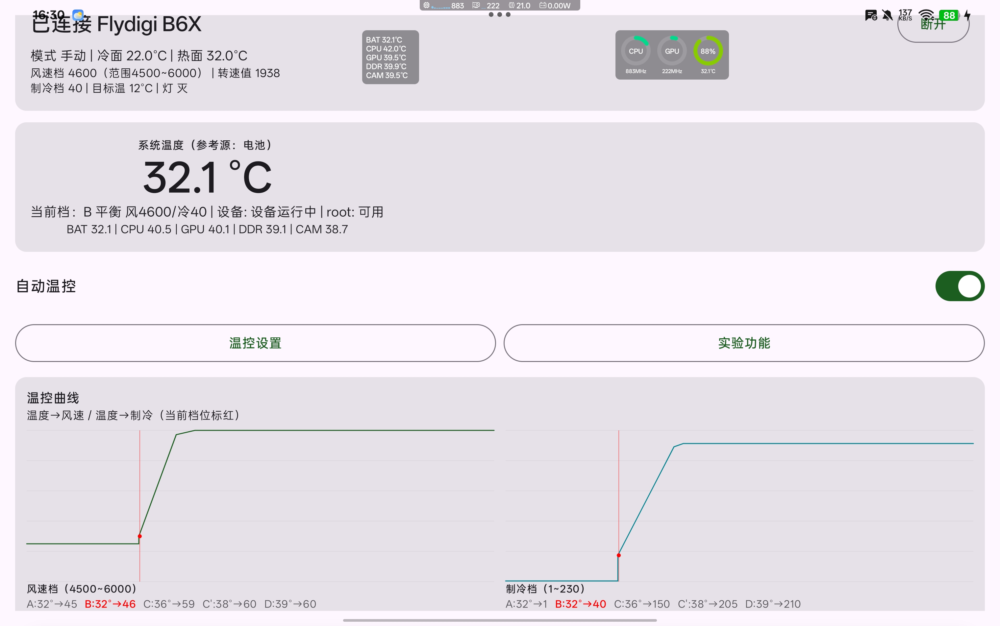

# SmartCool — 提供智能动态散热

平板在 chroot 里跑着 Ubuntu 做开发，但官方散热 App 只看散热器自己背面的温度——静态调度策略，热面发热严重，噪音权衡差，冷凝水风险等。

**SmartCool** 读取**真实系统温度**（CPU / GPU / DDR / 摄像头 / 电池，来自 sysfs），用 **PC 风扇式温控曲线**驱动飞智 B6X 磁吸散热器，兼顾：

- ⚡ **能效**——系统凉爽时停在 A 档（制冷 1 / 风速 4000）省电静音
- 🌡️ **热面冗余**——风速始终保留足够余量排走热面热量，静音微调
- ❄️ **冷面制冷**——高负载时升到 D 档（制冷 200 / 风速 7200）压住冷面
- 💧 **冷凝水安全**——不会过度制冷使得机器内部冷凝水

> 因为手边恰好只有 B6X，就把它调到了相对甜点设置。

---

## 功能

- ✅ **真实系统温度**：按 thermal zone type 匹配分类（CPU/GPU/DDR/CAM），过滤 `cpu-hw-trip` 等阈值假源，范围校验；电池温度三级候选链（power_supply sysfs → thermal_zone 电池 zone → 系统广播），非 root 也实时
- ✅ **PC 风扇式 5 档温控曲线**：A/B/C/C'/D 每档可自定义「触发温度 + 制冷档 + 风速」，温度达到阈值即切档（升/降档皆实时）
- ✅ **温度源可选**：CPU/GPU 最高、CPU、GPU、电池、DDR、CAM、全部最高
- ✅ **BLE 直连 B6X**：0x23 手动命令，风速 4000~7500、制冷 1~230（实机校准，可调上限 230）
- ✅ **后台持续温控**：前台服务（`connectedDevice`）+ 常驻通知，退后台/锁屏照常工作
- ✅ **温控曲线可视化**：首页展示「温度→风速/制冷」阶梯曲线 + 当前温度实时标注（平板并排 / 手机垂直）
- ✅ **手动模式**：风速/制冷双滑杆，0~100%；滑动防抖（停顿后发送最终值，不逐%刷命令）；手动干预后重开自动温控立即切回曲线挡位
- ✅ **设备掉电保持**：固件记住最后档位，断电/重启无需重设
- ✅ **设置持久化**：DataStore 保存档位曲线、温度源、采样间隔、调试开关
- ✅ **自动重连开关**：设置页 / 控制中心磁贴一键切换；关闭后断开不再自动重连，手动连接始终可用；开启后立即尝试连接
- ✅ **配置导出/导入**：JSON 导出（系统保存对话框选位置）/ 文件导入（不含设备 MAC）；保存或导入后立即按当前温度重发挡位命令，配置热更新实时生效
- ✅ **实时状态通知**：常驻通知两行显示挡位 / 风速(设备实际) / 制冷 / 连接与自动重连状态 + 冷面 / 热面 / 参考温度（跟随温控参考源）

## 界面预览



## 工作原理

```text
UI (Compose) ⇄ ViewModel ⇄ ControlService(前台服务) ⇄ BleManager ⇄ B6X(BLE 0xFFE0)
                          │
                          ├─ TempReader（/sys/class/thermal 分类 + 范围过滤 + 电池广播）
                          └─ ThermalController（5 档曲线状态机，可单测）
```

- **温度**：读 `/sys/class/thermal/thermal_zone*/{type,temp}`，按 type 匹配 cpu/gpu/ddr/cam，跳过 `trip/crit/max/limit` 阈值传感器，范围过滤后取各类最高
- **电池温度三级候选链**：`power_supply` 实时 sysfs → `thermal_zone` 电池类 zone（世界可读）→ `ACTION_BATTERY_CHANGED` 广播（系统节流，滞后，最后兜底）。部分机型 `power_supply` 对普通 app 权限收紧，第二级保证非 root 下仍实时
- **协议**：B6X 手动命令 `0x23 <制冷档> <风速/100> <风速%100>`，4 字节；写间隔 ≥35ms，NO_RESPONSE
- **曲线**：温度达到某档阈值即切档，档位变化才下发命令（避免重复刷）

## 安装

```bash
# 构建（见下）后安装
adb install -r app/build/outputs/apk/debug/app-debug.apk
```

首次启动授权：

- **附近设备**（`BLUETOOTH_SCAN` / `BLUETOOTH_CONNECT`，Android 12+）
- **定位**（旧版 Android 扫描 BLE 需要，兼容保留）
- **通知**（前台服务常驻通知）

> 温度读取无需 root（`/sys/class/thermal` world-readable）；root 只作为权限收紧文件的读取兜底，非 root 下自动降级、功能完整。

## 使用

1. 打开 App → **连接**（自动扫描 `Flydigi` 设备）
2. 保持 **自动温控** 开启，App 按系统温度逐档调度
3. **温控设置**：编辑 5 档曲线（温度阈值/制冷/风速）、温度源、采样间隔、自动重连开关、恢复默认；**导出/导入**配置（JSON，导出后可分享/备份，导入后立即生效）
4. 需要时切**手动模式**（风速/制冷滑杆）
5. 常用入口：下拉通知栏看实时状态（挡位/风速/制冷/冷热面/参考温度）；控制中心添加「自动重连」磁贴快捷切换
6. 出问题时开启「界面设置 → 显示状态包/最近命令」排查

> 默认曲线（实机调校）：A 31°C/1/4000 · B 33°C/40/4500 · C 36°C/130/6500 · C' 38°C/180/6800 · D 40°C/200/7200

## 构建

```bash
./gradlew assembleDebug        # 构建 APK
./gradlew testDebugUnitTest    # 单元测试（协议 + 曲线状态机 + 配置编解码）
```

- AGP 9.3.1 / Gradle 9.6.1 / Kotlin 2.2.20 / compileSdk 35 / minSdk 26
- 产物：`app/build/outputs/apk/debug/app-debug.apk`

## 测试

- `WaspWingProtocolTest`：命令构造（0x23 格式、制冷 clamp）+ 0x13 状态包解析（实测样本）
- `ThermalControllerTest`：5 档曲线升降档、档位跳变、首次下发、手动模式、配置热更新、手动干预后重发
- `AppRepositoryConfigCodecTest`：配置导出/导入编解码（往返一致、非法输入、越界收敛）

## 免责声明

- 本项目**非官方**，与飞智（Flydigi）无任何关联；协议经由对官方 App 的学习研究获得，仅供个人学习与使用
- 使用本项目造成的任何设备损坏、温度异常等后果自行承担
- 请勿将本项目用于侵犯第三方权益的用途

## License

[MIT](LICENSE)
